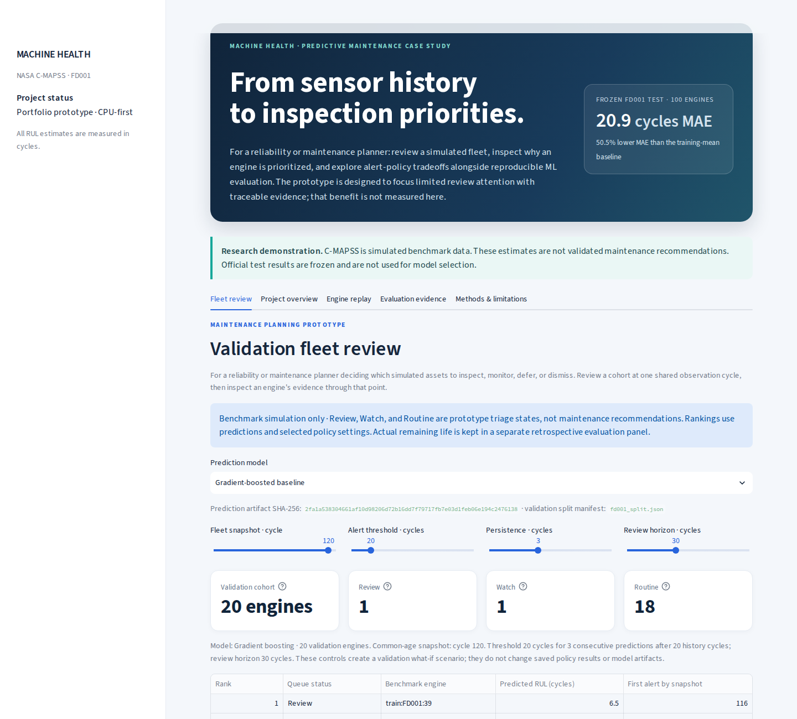
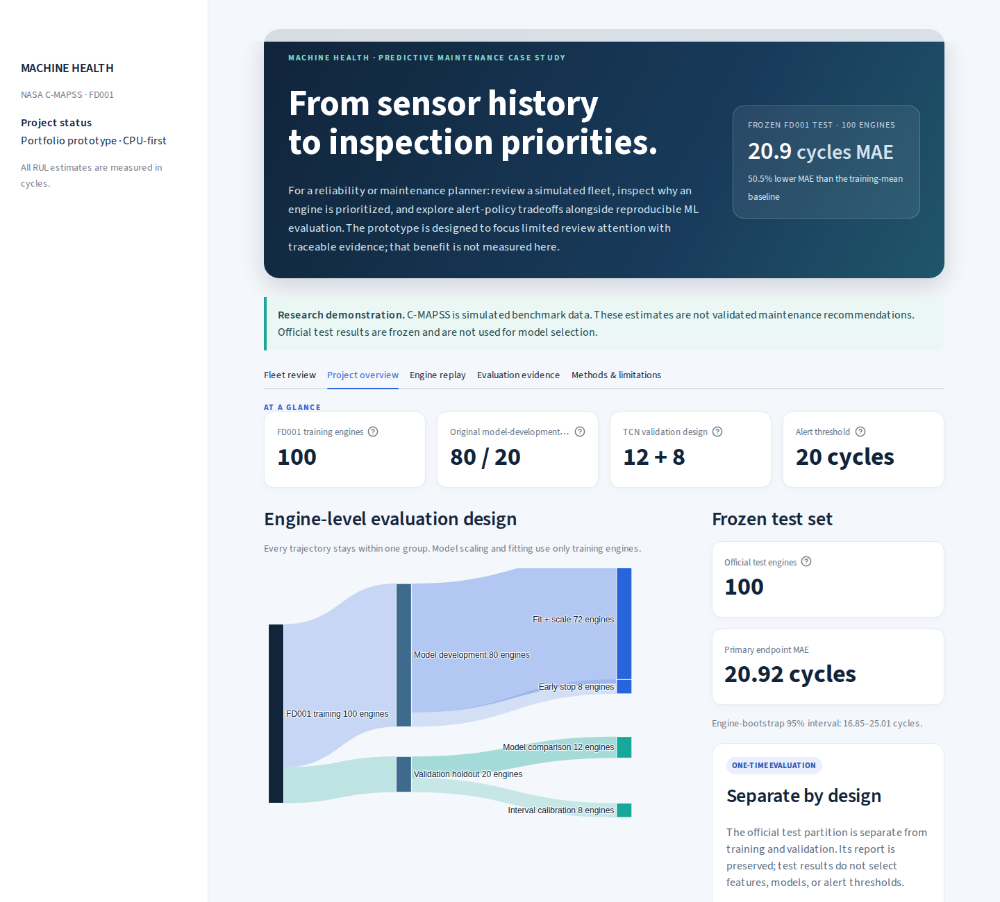
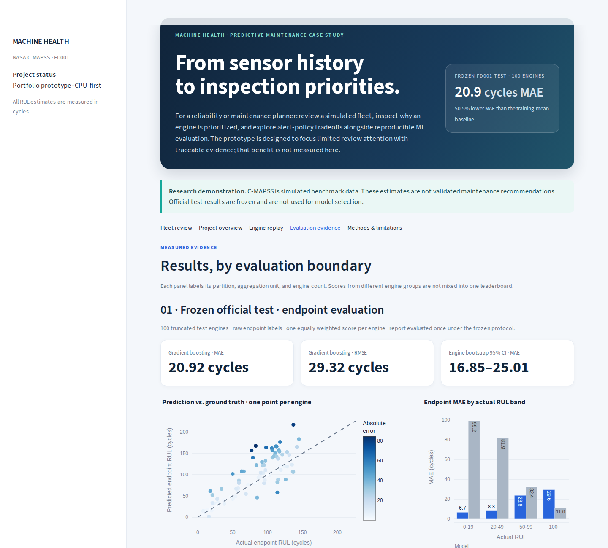
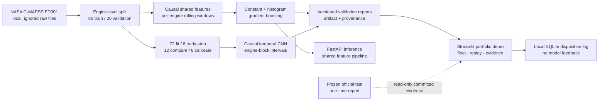

# Five-minute project walkthrough

## Start with committed evidence

From a fresh clone, use the [README quick demo](../README.md#quick-demo-from-a-fresh-clone). It installs the locked project dependencies and opens the dashboard without downloading the NASA data or training a model. The committed JSON reports power the overview, evaluation, and methods pages. The fleet review and recorded replay need ignored local data and artifacts; their prerequisite messages include the commands to build them.

Use the tabs in this order:

1. **Fleet review:** inspect the shared-cycle validation queue and its scope. Select an engine to review predictions and sensors available through the snapshot. The disposition form records local prototype state only.
2. **Project overview:** inspect engine-level partitions and the frozen FD001 endpoint result.
3. **Engine replay:** after preparing local data and training artifacts, replay one held-out engine through time. Actual RUL is retrospective evaluation evidence.
4. **Evaluation evidence:** compare validation results, frozen official-test endpoint metrics, TCN interval summaries, and the validation alert-policy scenario. Keep cohort and metric denominators in view.
5. **Methods & limitations:** inspect causal feature construction, split design, interval calibration, and benchmark limitations.

## Browser captures

These images were captured from the running Streamlit app with the real committed reports and local FD001 artifacts. The browser check returned HTTP 200, produced no page errors, and had no horizontal document overflow at desktop or 390-pixel mobile viewport widths. The image set shows separate live tabs; screenshots are not synthetic mockups.

The official test result is a preserved one-time benchmark report. Interactive views do not load the official test sensor records or labels. All cycle values are simulated benchmark cycles, not hours.

## Architecture

The flow keeps complete engines together across partitions. The frozen-test node has no path into model fitting, alert selection, or interactive replay. See [evaluation protocol](EVALUATION_PROTOCOL.md) and [model card](MODEL_CARD.md) for the detailed contracts.

## Local prerequisites for replay and retraining

Raw NASA data, trained artifacts, generated replay files, the run index, and local disposition history are intentionally ignored by Git. Follow the README commands to acquire or import FD001 data, prepare it, train the baseline, and generate the replay. Install CPU PyTorch only for the optional TCN. No GPU is required. The public report views remain available without these local files.
